# TP2 REST : Service web « Calculatrice » avec JAX-RS et Tomcat

| | |
|---|---|
| **Établissement** | Faculté des Sciences de Sfax, Département d'informatique et des Communications |
| **Matière** | Architecture MicroServices |
| **Filière** | MPSRCC1 |
| **Année universitaire** | 2026-2027 |
| **Enseignantes** | Corinne Amel ZAYANI, Amal ABID |
| **Réalisé par** | *(Nom Prénom)* |

---

## Table des matières

1. [Introduction et objectifs](#1-introduction-et-objectifs)
2. [Environnement de travail](#2-environnement-de-travail)
3. [Partie A : Conception du service](#3-partie-a--conception-du-service)
4. [Partie B : Création du projet Maven](#4-partie-b--création-du-projet-maven)
5. [Test préliminaire : Hello World](#5-test-préliminaire--hello-world)
6. [Partie C : Premier service REST, la somme](#6-partie-c--premier-service-rest--la-somme)
7. [Partie D : Soustraction et produit](#7-partie-d--soustraction-et-produit)
8. [Récapitulatif des tests](#8-récapitulatif-des-tests)
9. [Conclusion](#9-conclusion)
10. [Annexe : structure du dépôt](#10-annexe--structure-du-dépôt)

---

## 1. Introduction et objectifs

Dans ce TP, nous développons un **service web REST** qui expose une calculatrice avec **JAX-RS** (implémentation Jersey). Il est déployé dans le serveur **Apache Tomcat 10.1**, puis testé avec un navigateur, **curl** et **Postman**.

Ce compte rendu couvre le test Hello World, puis les trois premiers calculs : **somme**, **soustraction** et **produit**.

### Objectifs pédagogiques et où ils sont traités

| Objectif du TP | Traité dans |
|---|---|
| Concevoir une ressource REST : choisir ses URI et les verbes HTTP adaptés | [Partie A](#3-partie-a--conception-du-service) |
| Créer un projet Maven de type application web (`.war`) | [Partie B](#4-partie-b--création-du-projet-maven) |
| Écrire un service REST avec les annotations JAX-RS | [Hello World](#5-test-préliminaire--hello-world), [Parties C et D](#6-partie-c--premier-service-rest--la-somme) |
| Déployer l'application dans Tomcat | [C.4 et C.5](#c4-construire-le-fichier-war) |
| Échanger des données (texte brut ici, JSON dans la suite du TP) | [C.3](#c3-la-ressource-rest--classe-calculrest) |
| Tester un service avec curl et Postman et interpréter les codes de statut HTTP | [C.7](#c7-tester-le-service) et [D](#7-partie-d--soustraction-et-produit) |

---

## 2. Environnement de travail

| Outil | Version utilisée |
|---|---|
| JDK | 17 ou supérieur |
| Maven | 3.9+ (intégré à IntelliJ IDEA) |
| Apache Tomcat | **10.1.61** |
| IDE | IntelliJ IDEA |
| Clients de test | Navigateur, curl, Postman |

> **Pourquoi Tomcat 10.1 ?** Le TP utilise les paquetages `jakarta.*` (Jakarta EE 10). Tomcat 9 et les versions antérieures utilisent les anciens paquetages `javax.*`, et l'application n'y démarrerait pas.

---

## 3. Partie A : Conception du service

Avant de coder, on choisit les ressources, les URI et les verbes HTTP.

### Famille 1 : calculs directs (rien n'est enregistré sur le serveur)

| Verbe | URI | Rôle |
|---|---|---|
| GET | `/calcul/somme?a=2&b=3` | Retourne a + b |
| GET | `/calcul/soustraction?a=2&b=3` | Retourne a − b |
| GET | `/calcul/produit?a=2&b=3` | Retourne a × b |
| GET | `/calcul/division?a=6&b=3` | Retourne a ÷ b |

### Famille 2 : historique des opérations (ressource `operations`)

| Verbe | URI | Rôle |
|---|---|---|
| POST | `/operations` | Crée une opération (calcul effectué et enregistré) |
| GET | `/operations` | Retourne toutes les opérations |
| GET | `/operations/{id}` | Retourne l'opération numéro id |
| PUT | `/operations/{id}` | Modifie l'opération numéro id |
| DELETE | `/operations/{id}` | Supprime l'opération numéro id |

### Réponses aux questions de conception

**1. Pourquoi les calculs directs utilisent-ils le verbe GET et non POST ?**
Un calcul direct est une simple **lecture** : le client demande un résultat et le serveur ne crée ni ne modifie rien. GET est le verbe prévu pour cela. Il est **sûr** (aucun effet de bord) et **idempotent** (répéter la requête donne le même résultat). Il permet aussi de tester l'URL directement dans un navigateur. POST sert à créer une ressource.

**2. Comment s'appelle la partie située après le `?` dans `/calcul/somme?a=2&b=3` ?**
C'est la **chaîne de requête** (*query string*). Elle contient des **paramètres de requête** (*query parameters*) sous la forme `nom=valeur`, séparés par `&`. Ici, `a=2` et `b=3`.

**3. Quelle différence y a-t-il entre `/operations` et `/operations/3` ?**
`/operations` désigne la **collection** de toutes les opérations. `/operations/3` désigne **une ressource précise** de cette collection, celle dont l'identifiant est 3.

**4. Quel code de statut HTTP pour `/operations/99` si cette opération n'existe pas ?**
Le code **404 (Not Found)**, qui signale que la ressource demandée n'existe pas.

---

## 4. Partie B : Création du projet Maven

### B.1 Création du projet dans IntelliJ IDEA

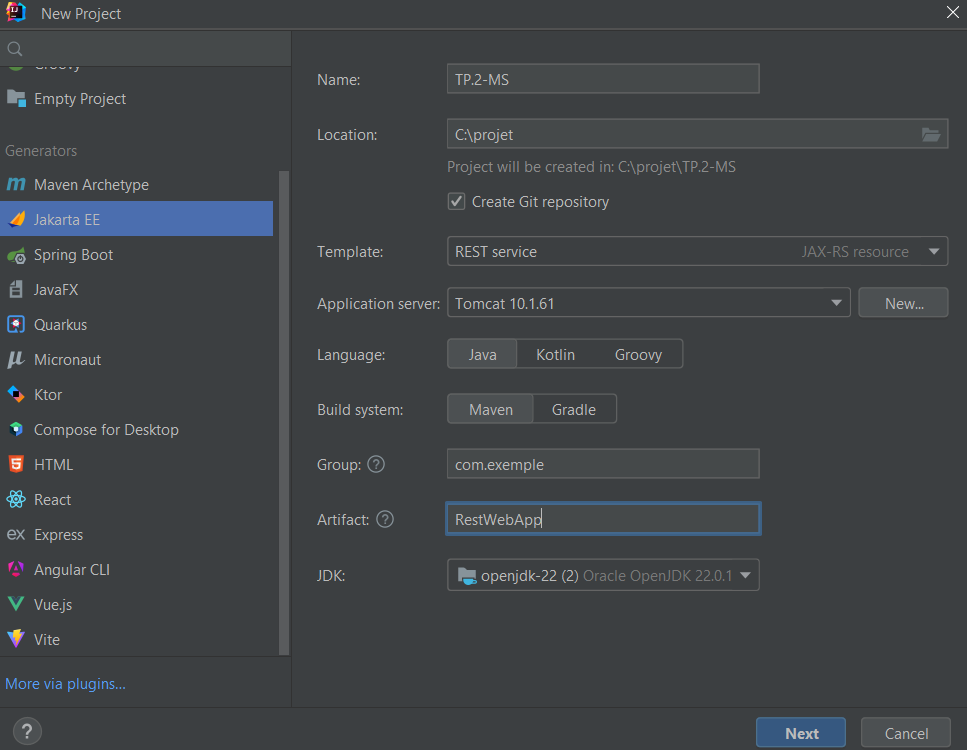
*Figure 1 : fenêtre New Project (générateur Jakarta EE)*
Sur l'écran suivant : version **Jakarta EE 10**, dépendances du modèle conservées, puis **Create**.

### B.2 Structure du projet

Le paquetage `com.exemple.rest` est créé dans `src/main/java`.

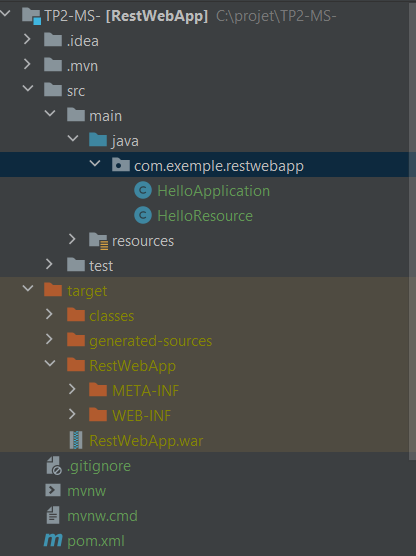
*Figure 2 : structure du projet générée par le modèle (HelloApplication et HelloResource)*

### B.3 Configuration du `pom.xml`

Le contenu du `pom.xml` est remplacé par la configuration du TP. Elle contient les éléments suivants.

```xml
<packaging>war</packaging>  <!-- Application web -->

<properties>
    <project.build.sourceEncoding>UTF-8</project.build.sourceEncoding>
    <jersey.version>3.1.9</jersey.version>
</properties>
```

| Dépendance | Rôle |
|---|---|
| `jakarta.ws.rs-api` 3.1.0 | API JAX-RS : annotations `@Path`, `@GET`, etc. |
| `jersey-container-servlet` | Intégration de Jersey avec le conteneur de servlets (Tomcat) |
| `jersey-hk2` | Moteur d'injection, indispensable au démarrage de Jersey |
| `jersey-media-json-binding` | Conversion automatique objet Java ↔ JSON |

Points importants :

- `<packaging>war</packaging>` : Maven produit une **application web** (`.war`) et non un `.jar`.
- `<finalName>RestWebApp</finalName>` : fixe le nom du fichier `RestWebApp.war`. Ce nom apparaît dans l'URL du service.
- Aucun `web.xml` n'est nécessaire : l'annotation `@ApplicationPath` le remplace.

### B.4 Vérification

Après avoir rechargé le projet Maven (**Reload All Maven Projects**), les dépendances sont téléchargées et le projet compile sans erreur.


---

## 5. Test préliminaire : Hello World

Avant d'écrire notre propre service, nous vérifions que la chaîne **IntelliJ → Maven → Tomcat → Jersey** fonctionne, avec l'exemple généré par le modèle.

### 5.1 Les classes générées

**`HelloApplication`** : active JAX-RS sous le préfixe `/api`.

```java
package com.exemple.rest;

import jakarta.ws.rs.ApplicationPath;
import jakarta.ws.rs.core.Application;

@ApplicationPath("/api")
public class HelloApplication extends Application {
}
```

**`HelloResource`** : ressource d'exemple.

```java
package com.exemple.rest;

import jakarta.ws.rs.GET;
import jakarta.ws.rs.Path;
import jakarta.ws.rs.Produces;

@Path("/hello-world")
public class HelloResource {
    @GET
    @Produces("text/plain")
    public String hello() {
        return "Hello, World!";
    }
}
```

### 5.2 Configuration de Tomcat dans IntelliJ

Le modèle crée une configuration d'exécution nommée **Tomcat 10.1.61** (`Run > Edit Configurations...`).

- **Onglet Server** : serveur utilisé (Tomcat 10.1.61), navigateur lancé après le démarrage et URL ouverte (`http://localhost:8080/RestWebApp_war_exploded/`).
- **Onglet Deployment** : artefact déployé au démarrage, `RestWebApp:war exploded`. C'est l'application sous forme de **dossier non compressé**, pratique en développement.

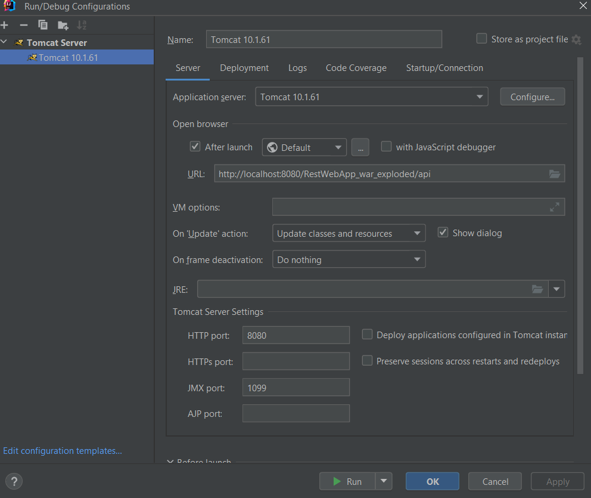
*Figure 3 : configuration Tomcat, onglet Server*


> **Contexte de l'application.** Avec l'artefact *war exploded*, le contexte par défaut est `/RestWebApp_war_exploded`. Avec un déploiement manuel du fichier `RestWebApp.war` dans `TOMCAT_HOME/webapps`, le contexte est `/RestWebApp`, c'est-à-dire le `finalName`. Les URL du sujet utilisent `/RestWebApp`. Avec le lancement depuis IntelliJ, il faut donc utiliser `/RestWebApp_war_exploded`, ou changer le champ *Application context* dans l'onglet Deployment.

### 5.3 Lancement et test

On clique sur **Run** : Tomcat démarre et déploie l'application. Le test se fait à l'URL :

```
http://localhost:8080/RestWebApp_war_exploded/api/hello-world
```

| Partie de l'URL | Origine |
|---|---|
| `localhost:8080` | Machine locale, port par défaut de Tomcat |
| `/RestWebApp_war_exploded` | Contexte de l'application |
| `/api` | `@ApplicationPath("/api")` |
| `/hello-world` | `@Path("/hello-world")` |

**Test avec le navigateur**


*Figure 4 : la page affiche « Hello, World! »*

**Test avec curl**

```bash
curl -i "http://localhost:8080/RestWebApp_war_exploded/api/hello-world"
```

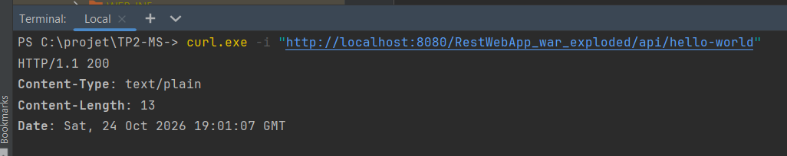
*Figure 5 : réponse `HTTP/1.1 200`, `Content-Type: text/plain`, corps `Hello, World!`*

**Résultat : le serveur est opérationnel, Jersey démarre et l'annotation JAX-RS est bien prise en compte.**

### 5.4 Avant de passer à la calculatrice

Le modèle génère `HelloApplication`, et le TP demande de créer `RestApplication` (étape C.2). **Il ne doit exister qu'une seule classe `@ApplicationPath` dans le projet.** Sinon Jersey signale un conflit à l'exécution. Nous avons donc supprimé `HelloApplication` après le test Hello World (`HelloResource` peut être conservée ou supprimée).

---

## 6. Partie C : Premier service REST, la somme

### C.1 La logique métier : classe `Calculatrice`

Cette classe ne connaît **ni HTTP ni REST** : c'est une classe Java ordinaire. Elle sépare la logique métier de l'exposition sur le Web.

```java
package com.exemple.rest;

public class Calculatrice {

    public int somme(int a, int b) {
        return a + b;
    }

    public int soustraction(int a, int b) {
        return a - b;
    }

    public int produit(int a, int b) {
        return a * b;
    }

    public double division(int a, int b) {
        if (b == 0) {
            throw new ArithmeticException("Division par 0 impossible");
        }
        return (double) a / b;
    }
}
```

### C.2 Activation de JAX-RS : classe `RestApplication`

```java
package com.exemple.rest;

import jakarta.ws.rs.ApplicationPath;
import jakarta.ws.rs.core.Application;

@ApplicationPath("/api")
public class RestApplication extends Application {
    // L'annotation suffit pour activer JAX-RS
}
```

`@ApplicationPath("/api")` signifie que **toutes les URI du service commencent par `/api`**.

### C.3 La ressource REST : classe `CalculRest`

```java
package com.exemple.rest;

import jakarta.ws.rs.GET;
import jakarta.ws.rs.Path;
import jakarta.ws.rs.Produces;
import jakarta.ws.rs.QueryParam;
import jakarta.ws.rs.core.MediaType;
import jakarta.ws.rs.core.Response;

@Path("/calcul")
public class CalculRest {

    private final Calculatrice calculService = new Calculatrice();

    @GET
    @Path("/somme")
    @Produces(MediaType.TEXT_PLAIN)
    public Response somme(@QueryParam("a") int a, @QueryParam("b") int b) {
        int result = calculService.somme(a, b);
        return Response.ok(result).build();
    }
}
```

| Annotation | Rôle |
|---|---|
| `@Path("/calcul")` (classe) | Toutes les méthodes de la classe répondent sous `/calcul` |
| `@GET` | La méthode répond aux requêtes de verbe GET |
| `@Path("/somme")` (méthode) | Complète l'URI : `/calcul/somme` |
| `@Produces(MediaType.TEXT_PLAIN)` | La réponse est du texte brut (`text/plain`) |
| `@QueryParam("a")` | Lit le paramètre `a` de l'URI (`?a=2`) et le convertit en entier |

`Response.ok(result).build()` construit une réponse de statut **200 (OK)** dont le corps contient le résultat.

### C.4 Construire le fichier `.war`

Deux méthodes sont possibles.

**Avec Maven, en terminal :**

```bash
mvn clean package
```

Résultat attendu : `BUILD SUCCESS` et le fichier `target/RestWebApp.war`.

**Avec IntelliJ :** menu `Build > Build Project`, ou `Build > Build Artifacts...`.

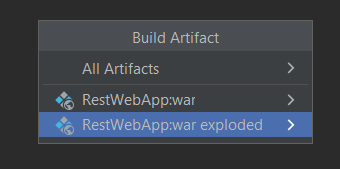
*Figure 6 : menu Build d'IntelliJ IDEA*

### C.5 Déploiement dans Tomcat

Le déploiement se fait via la configuration **Tomcat 10.1.61** décrite au [§5.2](#52-configuration-de-tomcat-dans-intellij). L'artefact `RestWebApp:war exploded` est déployé au démarrage. Après chaque modification du code, il faut **reconstruire puis redéployer** (ou utiliser *Update resources* / *Redeploy*).

### C.6 Comprendre l'URL du service

```
http://localhost:8080/RestWebApp/api/calcul/somme?a=2&b=3
```

| Partie de l'URL | Origine |
|---|---|
| `localhost:8080` | Machine locale et port par défaut de Tomcat |
| `/RestWebApp` | Nom du fichier `.war` (`<finalName>` du `pom.xml`) |
| `/api` | `@ApplicationPath("/api")` |
| `/calcul` | `@Path("/calcul")` de la classe |
| `/somme` | `@Path("/somme")` de la méthode |
| `?a=2&b=3` | Paramètres de requête lus par `@QueryParam` |

> Dans la suite, l'URL de base utilisée est `http://localhost:8080/RestWebApp_war_exploded/api` (lancement depuis IntelliJ). Elle est notée `BASE` dans les tableaux.

### C.7 Tester le service

**a) Avec le navigateur**

URL : `BASE/calcul/somme?a=2&b=3`. Résultat attendu : la page affiche `5`.

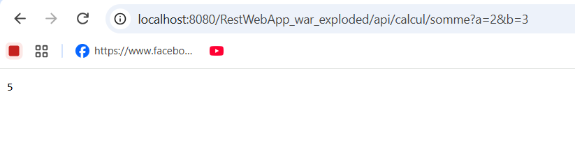
*Figure 10 : somme dans le navigateur, résultat 5*

**b) Avec Postman**

1. Nouvelle requête (bouton **New** ou **+**)
2. Verbe **GET** et saisie de l'URL
3. Clic sur **Send**
4. Observation du corps (`5`), du statut (`200 OK`) et de l'onglet **Headers**

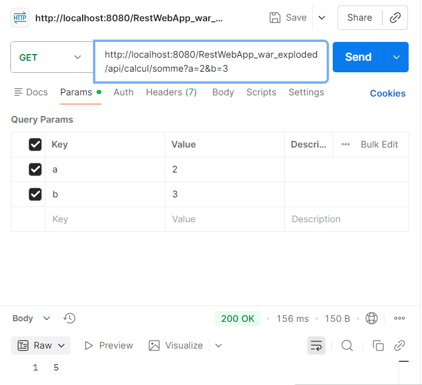
*Figure 12 : somme avec Postman, 200 OK et corps 5*

### Question C.1 : que se passe-t-il avec POST à la place de GET ?

En remplaçant GET par POST dans Postman, on obtient le statut **405 Method Not Allowed**.

**Explication :** l'URI `/calcul/somme` existe, mais la méthode Java n'est annotée qu'avec `@GET`. Aucune méthode de la ressource ne répond au verbe POST pour cette URI. Jersey répond donc 405 (« méthode non autorisée pour cette ressource »), et non 404, car la ressource existe bien. La réponse contient aussi un en-tête `Allow` qui liste les verbes acceptés.

---

## 7. Partie D : Soustraction et produit

### D.1 Ajout des méthodes dans `CalculRest`

En s'inspirant de la méthode `somme`, nous ajoutons deux méthodes à la classe `CalculRest`.

```java
    @GET
    @Path("/soustraction")
    @Produces(MediaType.TEXT_PLAIN)
    public Response soustraction(@QueryParam("a") int a, @QueryParam("b") int b) {
        int result = calculService.soustraction(a, b);
        return Response.ok(result).build();
    }

    @GET
    @Path("/produit")
    @Produces(MediaType.TEXT_PLAIN)
    public Response produit(@QueryParam("a") int a, @QueryParam("b") int b) {
        int result = calculService.produit(a, b);
        return Response.ok(result).build();
    }
```

Après modification : **reconstruction et redéploiement**, puis tests.

### Tests de la soustraction et du produit

| Requête | Résultat attendu |
|---|---|
| `GET BASE/calcul/soustraction?a=10&b=4` | `6` |
| `GET BASE/calcul/produit?a=6&b=7` | `42` |

```bash
curl -i "http://localhost:8080/RestWebApp_war_exploded/api/calcul/soustraction?a=10&b=4"
curl -i "http://localhost:8080/RestWebApp_war_exploded/api/calcul/produit?a=6&b=7"
```

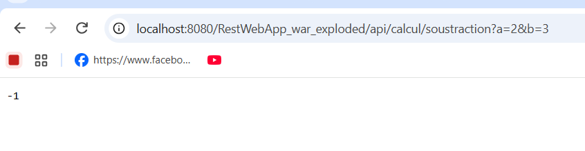
*Figure 14 : soustraction `a=10&b=4`, statut 200, résultat 6*

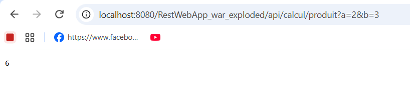
*Figure 15 : produit `a=6&b=7`, statut 200, résultat 42*
### D.2 Division et gestion d'erreur
 
#### Le problème : la division par zéro
 
Diviser par zéro est impossible. Dans ce cas, **l'erreur vient du client** : il a envoyé une valeur incorrecte. Le service doit donc répondre avec le statut **400 (Bad Request, requête incorrecte)**, et non avec un résultat faux ni avec une erreur interne du serveur.
 
| Code | Signification | Responsable | Convient pour la division par 0 ? |
|---|---|---|---|
| 200 | OK | , | Non : il n'y a pas de résultat valide |
| **400** | **Bad Request** | **Client** | **Oui : le client a envoyé `b=0`** |
| 500 | Internal Server Error | Serveur | Non : le serveur n'est pas en panne, c'est la requête qui est incorrecte |
 
Rappel : la classe `Calculatrice` lève une `ArithmeticException` quand `b == 0`. Si la ressource REST ne vérifiait rien, cette exception remonterait jusqu'à Jersey et le client recevrait un **500**. La ressource REST **vérifie donc `b` avant d'appeler la logique métier** et construit elle-même la réponse 400.
 
#### Code ajouté dans `CalculRest`
 
```java
    @GET
    @Path("/division")
    @Produces(MediaType.TEXT_PLAIN)
    public Response division(@QueryParam("a") int a, @QueryParam("b") int b) {
        if (b == 0) {
            return Response.status(Response.Status.BAD_REQUEST)
                           .entity("Erreur : division par 0 impossible")
                           .build();
        }
        double result = calculService.division(a, b);
        return Response.ok(result).build();
    }
```
 
Explication du code :
 
| Élément | Rôle |
|---|---|
| `@GET` + `@Path("/division")` | La méthode répond à `GET /calcul/division` |
| `@QueryParam("a")`, `@QueryParam("b")` | Lecture des deux opérandes dans la chaîne de requête |
| `if (b == 0)` | Détection du cas d'erreur **avant** le calcul |
| `Response.status(Response.Status.BAD_REQUEST)` | Statut **400** |
| `.entity("Erreur : ...")` | Corps de la réponse : message d'erreur lisible par le client |
| `double result = ...` | La division retourne un `double` (7 ÷ 2 = 3.5), contrairement aux trois autres opérations qui retournent un `int` |
| `Response.ok(result).build()` | Statut **200** avec le résultat dans le corps |
 
Après modification : **reconstruction et redéploiement**.
 
#### Tests
 
| Requête | Statut attendu | Corps attendu |
|---|---|---|
| `GET BASE/calcul/division?a=7&b=2` | 200 | `3.5` |
| `GET BASE/calcul/division?a=7&b=0` | 400 | `Erreur : division par 0 impossible` |
 
**Avec curl** (`-i` affiche le statut et les en-têtes) :
 
```bash
curl -i "http://localhost:8080/RestWebApp_war_exploded/api/calcul/division?a=7&b=2"
curl -i "http://localhost:8080/RestWebApp_war_exploded/api/calcul/division?a=7&b=0"
```
 

*Figure 14a : division `a=7&b=2`, statut 200, corps `3.5`*
 
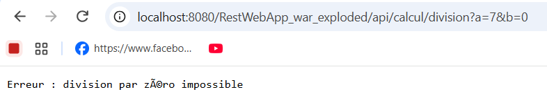
*Figure 14b : division `a=7&b=0`, statut 400, corps `Erreur : division par 0 impossible`*
 
 
#### Observations
 
- Le résultat de la division est un nombre **décimal** : `6 ÷ 3` donne `2.0` et non `2`, car la méthode retourne un `double`.
- Pour le cas d'erreur, le **statut HTTP** (400) indique le type d'erreur de façon standard, et le **corps** donne le détail à l'utilisateur. Un client programmé peut ainsi réagir au statut sans analyser le texte.
- Le message d'erreur est un texte brut (`text/plain`), comme les autres réponses de cette ressource. Dans la partie JSON du TP, il sera remplacé par un objet JSON.
### D.3 Observations : paramètres absents ou invalides

Deux requêtes ont été envoyées pour observer le comportement de JAX-RS.

| N° | Requête | Statut | Corps |
|---|---|---|---|
| 1 | `GET BASE/calcul/somme?a=2` (b absent) | **200** | `2` |
| 2 | `GET BASE/calcul/somme?a=abc&b=3` (a non entier) | **404** | page d'erreur Tomcat (corps vide ou HTML) |

*(À confirmer et compléter avec vos propres captures.)*

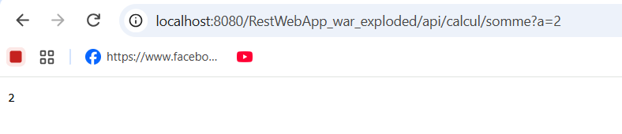
*Figure 16 : somme avec `b` absent*

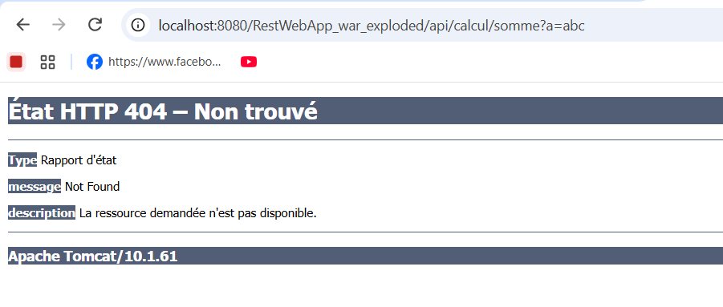
*Figure 17 : somme avec `a=abc`*

**Question D.1 : quelle valeur JAX-RS donne-t-il à un paramètre entier absent ?**
Pour un type primitif (`int`), JAX-RS affecte la **valeur par défaut Java, `0`**. Ici, `somme?a=2` calcule `2 + 0 = 2`. On peut imposer une autre valeur avec `@DefaultValue`, ou utiliser `Integer` pour recevoir `null`.

**Question D.2 : quel statut quand le paramètre n'est pas un entier ? La méthode `somme` a-t-elle été exécutée ?**
Le statut obtenu est **404 (Not Found)**. Pour un `@QueryParam`, JAX-RS ne parvient pas à convertir `"abc"` en `int` et refuse la requête avant d'appeler la méthode. **La méthode `somme` n'est donc pas exécutée.**

**Question D.3 : quelle différence entre `@QueryParam` et `@PathParam` ?**

| | `@QueryParam` | `@PathParam` |
|---|---|---|
| Emplacement | Après le `?` : `?a=6&b=7` | Dans le chemin : `/produit/6/7` |
| Déclaration | `@QueryParam("a")` | Variable `{a}` dans `@Path`, puis `@PathParam("a")` |
| Usage typique | Paramètres **optionnels**, filtres, tri, pagination | Valeurs qui **identifient** la ressource |
| Absence | Valeur par défaut (0 pour `int`) | Non applicable : le chemin ne correspond plus (404) |

Pour lire l'identifiant dans `/operations/{id}`, on utilisera **`@PathParam("id")`**, car l'identifiant fait partie du chemin et désigne la ressource.

---
## 8. Partie E : Échanger des données en JSON
 
Jusqu'ici, le service renvoie un simple nombre en **texte brut**. Une API REST renvoie le plus souvent un **objet structuré au format JSON**, que n'importe quel client (application web, mobile, autre service) peut lire facilement.
 
| | Texte brut (`text/plain`) | JSON (`application/json`) |
|---|---|---|
| Exemple | `5` | `{"a":2,"b":3,"operation":"somme","resultat":5.0}` |
| Contenu | Une seule valeur | Plusieurs champs nommés, auto-descriptifs |
| Lecture par un client | Il doit savoir ce que représente la valeur | Les noms des champs expliquent chaque valeur |
| Évolution | Difficile d'ajouter une information | On ajoute un champ sans casser les clients existants |
 
La dépendance **`jersey-media-json-binding`** du `pom.xml` fait cette conversion **automatiquement** : elle transforme un objet Java en JSON (et inversement). Elle s'appuie sur la norme **JSON-B** (Jakarta JSON Binding).
 
### E.1 La classe `Resultat`
 
Cette classe représente le résultat d'un calcul avec le détail de l'opération. Pour que la conversion en JSON fonctionne, elle doit posséder :
- un **constructeur public sans argument** (indispensable pour reconstruire l'objet à partir d'un JSON) ;
- des **accesseurs** (méthodes `get` et `set`) pour chaque propriété.
```java
package com.exemple.rest;
 
public class Resultat {
 
    private String operation;
    private int a;
    private int b;
    private double resultat;
 
    // Constructeur sans argument : obligatoire pour la conversion JSON
    public Resultat() {
    }
 
    public Resultat(String operation, int a, int b, double resultat) {
        this.operation = operation;
        this.a = a;
        this.b = b;
        this.resultat = resultat;
    }
 
    public String getOperation() { return operation; }
    public void setOperation(String operation) { this.operation = operation; }
 
    public int getA() { return a; }
    public void setA(int a) { this.a = a; }
 
    public int getB() { return b; }
    public void setB(int b) { this.b = b; }
 
    public double getResultat() { return resultat; }
    public void setResultat(double resultat) { this.resultat = resultat; }
}
```
 
 
### E.2 Une méthode qui produit du JSON
 
Ajout dans `CalculRest` d'une méthode `sommeDetail`. **Seule l'annotation `@Produces` change** par rapport à la méthode `somme` : elle annonce désormais le type `application/json`. La méthode renvoie un objet `Resultat` dans la réponse, sans aucun code de conversion.
 
```java
    @GET
    @Path("/somme/detail")
    @Produces(MediaType.APPLICATION_JSON)
    public Response sommeDetail(@QueryParam("a") int a, @QueryParam("b") int b) {
        Resultat resultat = new Resultat("somme", a, b, calculService.somme(a, b));
        return Response.ok(resultat).build();
    }
```
 
| Élément | Rôle |
|---|---|
| `@Path("/somme/detail")` | La méthode répond à `GET /calcul/somme/detail` (la méthode `somme` garde son URI `/calcul/somme`) |
| `@Produces(MediaType.APPLICATION_JSON)` | La réponse est du JSON (`Content-Type: application/json`) |
| `new Resultat("somme", a, b, ...)` | Objet Java qui décrit le calcul |
| `Response.ok(resultat)` | Statut 200, l'objet est placé dans le corps de la réponse ; Jersey le convertit en JSON |
 
Après modification : **reconstruction et redéploiement**, puis test.
 
```bash
curl -i "http://localhost:8080/RestWebApp_war_exploded/api/calcul/somme/detail?a=2&b=3"
```
 
Résultat attendu :
- statut **200** ;
- en-tête `Content-Type: application/json` ;
- corps :
```json
{"a":2,"b":3,"operation":"somme","resultat":5.0}
```

 
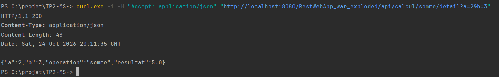
*Figure E3 : la même URL dans le navigateur affiche le JSON*
 
#### Question E.1 : qui a effectué la conversion en JSON ? D'où viennent les noms `a`, `b`, `operation` et `resultat` ?
 
**Qui a converti ?** La conversion est faite par **Jersey**, grâce à la dépendance **`jersey-media-json-binding`**. Cette dépendance enregistre dans Jersey un *fournisseur JSON* (basé sur JSON-B, avec l'implémentation Yasson). Quand une méthode renvoie un objet et que le type de réponse est `application/json`, Jersey passe l'objet à ce fournisseur, qui produit le texte JSON. Le développeur n'écrit aucun code de conversion.
 
**D'où viennent les noms ?** Ils viennent des **accesseurs (getters)** de la classe `Resultat`, selon la convention JavaBeans : on retire le préfixe `get` et on met la première lettre en minuscule.
 
| Getter | Nom du champ JSON |
|---|---|
| `getA()` | `a` |
| `getB()` | `b` |
| `getOperation()` | `operation` |
| `getResultat()` | `resultat` |
 
Deux conséquences à retenir :
- Si l'on renomme un getter, le nom du champ JSON change. Les attributs `private` ne sont pas lus directement.
- Les champs apparaissent dans l'**ordre alphabétique** (`a`, `b`, `operation`, `resultat`), ce qui explique que le JSON n'a pas le même ordre que les attributs de la classe.
Le type `double` explique aussi `5.0` et non `5` : `resultat` est un `double`.
 
### E.3 L'en-tête `Accept`
 
Le client indique le format qu'il souhaite recevoir avec l'en-tête HTTP **`Accept`**. Le serveur compare cette demande avec ce que la méthode sait produire (`@Produces`) : c'est la **négociation de contenu**. Avec curl, l'option `-H` ajoute un en-tête à la requête.
 
```bash
curl -i -H "Accept: application/json" "http://localhost:8080/RestWebApp_war_exploded/api/calcul/somme/detail?a=2&b=3"
 
curl -i -H "Accept: application/xml" "http://localhost:8080/RestWebApp_war_exploded/api/calcul/somme/detail?a=2&b=3"
```
 
| Requête | Accept | Statut | Résultat |
|---|---|---|---|
| 1 | `application/json` | **200** | Le JSON est renvoyé |
| 2 | `application/xml` | **406 Not Acceptable** | Aucun corps utile : le serveur refuse |
 
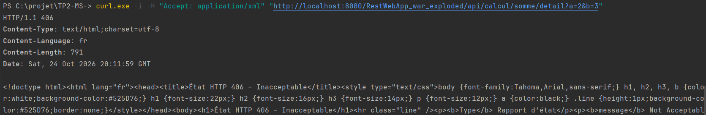
*Figure E4 : `Accept: application/json`, statut 200 et corps JSON*
 
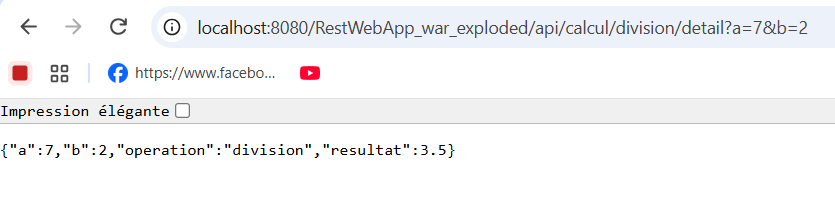
*Figure E5 : `Accept: application/xml`, statut 406 Not Acceptable*
 
**Avec Postman :** onglet **Headers** de la requête, ajouter la ligne `Accept` avec la valeur `application/json`, puis `application/xml`. Postman envoie par défaut `Accept: */*`, qui accepte tous les formats.
 
#### Question E.2 : pourquoi la seconde requête est-elle refusée ?
 
La méthode `sommeDetail` est annotée `@Produces(MediaType.APPLICATION_JSON)` : elle ne sait produire **que du JSON**. Le client demande du **XML** avec `Accept: application/xml`. Jersey ne trouve aucune méthode capable de répondre dans le format demandé et répond **406 (Not Acceptable)**, qui signifie « je ne peux pas fournir une représentation que vous acceptez ». Aucune conversion en XML n'est tentée.
 
Ce comportement distingue 406 et 405 :
- **405** : le *verbe* n'est pas accepté pour cette URI ;
- **406** : le *format de réponse* demandé n'est pas disponible.
Pour accepter aussi le XML, il faudrait ajouter `MediaType.APPLICATION_XML` dans `@Produces` et fournir un fournisseur XML (JAXB, par exemple).
 
### E.4 Exercice : `divisionDetail`
 
Ajout dans `CalculRest` d'une méthode accessible par `GET /calcul/division/detail?a=..&b=..`, qui renvoie un objet `Resultat` en JSON. Si `b` vaut 0, elle renvoie le statut **400**.
 
```java
    @GET
    @Path("/division/detail")
    @Produces(MediaType.APPLICATION_JSON)
    public Response divisionDetail(@QueryParam("a") int a, @QueryParam("b") int b) {
        if (b == 0) {
            return Response.status(Response.Status.BAD_REQUEST)
                           .entity("{\"erreur\":\"Division par 0 impossible\"}")
                           .build();
        }
        Resultat resultat = new Resultat("division", a, b, calculService.division(a, b));
        return Response.ok(resultat).build();
    }
```
 
Le principe est identique à la division en texte brut (partie D.2) : le cas d'erreur est détecté **avant** le calcul. La différence est que le message d'erreur est lui aussi au format JSON, pour rester cohérent avec `@Produces(MediaType.APPLICATION_JSON)`.
 
Tests :
 
| Requête | Statut attendu | Corps attendu |
|---|---|---|
| `GET BASE/calcul/division/detail?a=7&b=2` | 200 | `{"a":7,"b":2,"operation":"division","resultat":3.5}` |
| `GET BASE/calcul/division/detail?a=7&b=0` | 400 | `{"erreur":"Division par 0 impossible"}` |
 
```bash
 "http://localhost:8080/RestWebApp_war_exploded/api/calcul/division/detail?a=7&b=2"
 "http://localhost:8080/RestWebApp_war_exploded/api/calcul/division/detail?a=7&b=0"
```
 
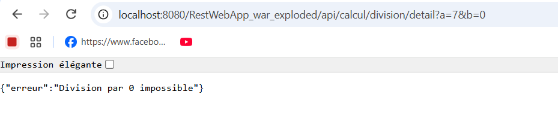
*Figure E6 : `division/detail?a=7&b=2`, statut 200 et JSON avec `resultat` à 3.5*
 
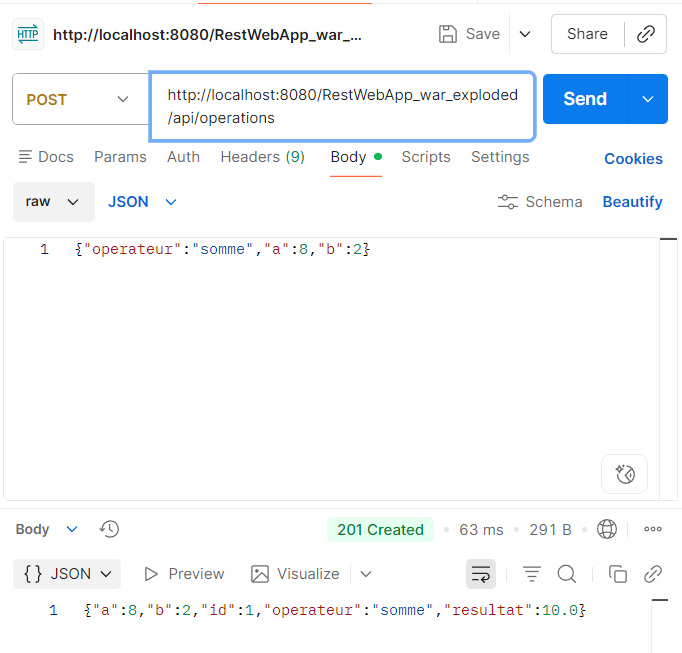
*Figure E7 : `division/detail?a=7&b=0`, statut 400 et message d'erreur JSON*
 
### Bilan de la partie E
 
- Une méthode REST peut **renvoyer directement un objet Java** : Jersey se charge de la conversion en JSON.
- La classe doit respecter la convention JavaBeans (constructeur sans argument, getters et setters).
- Le type de réponse est déclaré par `@Produces`, et le client exprime son souhait avec l'en-tête `Accept`.
- Un format non disponible donne **406**, une erreur de saisie du client donne **400**.
---
 
## 9. Partie F : La ressource operations (POST, GET, PUT, DELETE)
 
Les calculs directs n'utilisent que le verbe GET. Pour pratiquer les **quatre verbes HTTP**, nous réalisons maintenant l'**historique des opérations** conçu à l'étape A.1 : chaque opération enregistrée est une **ressource** que l'on peut créer, lire, modifier et supprimer (CRUD).
 
| Action | Verbe | URI | Statuts possibles |
|---|---|---|---|
| **C**reate : créer | POST | `/operations` | 201, 400 |
| **R**ead : lire la collection | GET | `/operations` | 200 |
| **R**ead : lire une opération | GET | `/operations/{id}` | 200, 404 |
| **U**pdate : modifier | PUT | `/operations/{id}` | 200, 400, 404 |
| **D**elete : supprimer | DELETE | `/operations/{id}` | 204, 404 |
 
> **Stockage en mémoire.** Les opérations sont conservées en mémoire, sans base de données. Elles sont donc **perdues à chaque redémarrage de Tomcat et à chaque redéploiement**, et la numérotation repart alors de 1. Pour retrouver les identifiants 1 et 2 du sujet, il faut redéployer avant la série de tests.
 
### F.1 La classe `Operation`
 
Une opération possède un identifiant, un opérateur, deux opérandes et un résultat. **Le client fournit `operateur`, `a` et `b` ; le serveur calcule `id` et `resultat`.**
 
```java
package com.exemple.rest;
 
public class Operation {
 
    private int id;
    private String operateur;   // "somme", "soustraction", "produit" ou "division"
    private int a;
    private int b;
    private double resultat;
 
    // Constructeur sans argument : obligatoire pour la conversion JSON
    public Operation() {
    }
 
    public int getId() { return id; }
    public void setId(int id) { this.id = id; }
 
    public String getOperateur() { return operateur; }
    public void setOperateur(String operateur) { this.operateur = operateur; }
 
    public int getA() { return a; }
    public void setA(int a) { this.a = a; }
 
    public int getB() { return b; }
    public void setB(int b) { this.b = b; }
 
    public double getResultat() { return resultat; }
    public void setResultat(double resultat) { this.resultat = resultat; }
}
```
 
Comme pour `Resultat`, le constructeur sans argument et les accesseurs sont indispensables : Jersey s'en sert pour **transformer le JSON reçu en objet** (méthodes `set`) et l'objet à renvoyer en JSON (méthodes `get`).
 
 
### F.2 La classe `OperationRest` : créer et lire
 
La classe réalise la création (POST) et les deux lectures (GET).
 
```java
package com.exemple.rest;
 
import jakarta.ws.rs.Consumes;
import jakarta.ws.rs.GET;
import jakarta.ws.rs.POST;
import jakarta.ws.rs.Path;
import jakarta.ws.rs.PathParam;
import jakarta.ws.rs.Produces;
import jakarta.ws.rs.core.Context;
import jakarta.ws.rs.core.MediaType;
import jakarta.ws.rs.core.Response;
import jakarta.ws.rs.core.UriInfo;
 
import java.net.URI;
import java.util.ArrayList;
import java.util.List;
import java.util.Map;
import java.util.concurrent.ConcurrentHashMap;
import java.util.concurrent.atomic.AtomicInteger;
 
@Path("/operations")
@Produces(MediaType.APPLICATION_JSON)
public class OperationRest {
 
    // "static" : partagés par toutes les requêtes (voir la remarque ci-dessous)
    private static final Map<Integer, Operation> OPERATIONS = new ConcurrentHashMap<>();
    private static final AtomicInteger COMPTEUR = new AtomicInteger(0);
 
    private final Calculatrice calculService = new Calculatrice();
 
    // Calcule le résultat et le range dans l'opération.
    // Retourne false si le calcul est impossible.
    private boolean calculer(Operation op) {
        if (op == null || op.getOperateur() == null) {
            return false;
        }
        switch (op.getOperateur()) {
            case "somme":
                op.setResultat(calculService.somme(op.getA(), op.getB()));
                return true;
            case "soustraction":
                op.setResultat(calculService.soustraction(op.getA(), op.getB()));
                return true;
            case "produit":
                op.setResultat(calculService.produit(op.getA(), op.getB()));
                return true;
            case "division":
                if (op.getB() == 0) {
                    return false;
                }
                op.setResultat(calculService.division(op.getA(), op.getB()));
                return true;
            default:
                return false;
        }
    }
 
    // POST /operations : crée une opération
    @POST
    @Consumes(MediaType.APPLICATION_JSON)
    public Response creer(Operation op, @Context UriInfo uriInfo) {
        if (!calculer(op)) {
            return Response.status(Response.Status.BAD_REQUEST)
                           .entity("{\"erreur\":\"Calcul impossible\"}")
                           .build();
        }
        int id = COMPTEUR.incrementAndGet();
        op.setId(id);
        OPERATIONS.put(id, op);
        URI location = uriInfo.getAbsolutePathBuilder().path(String.valueOf(id)).build();
        return Response.created(location).entity(op).build();
    }
 
    // GET /operations : retourne toutes les opérations
    @GET
    public List<Operation> lister() {
        return new ArrayList<>(OPERATIONS.values());
    }
 
    // GET /operations/{id} : retourne une opération
    @GET
    @Path("/{id}")
    public Response lire(@PathParam("id") int id) {
        Operation op = OPERATIONS.get(id);
        if (op == null) {
            return Response.status(Response.Status.NOT_FOUND).build();
        }
        return Response.ok(op).build();
    }
}
```
 
#### Points à comprendre
 
| Élément | Explication |
|---|---|
| `@Produces` sur la **classe** | S'applique à toutes les méthodes : toutes répondent en JSON |
| `@Consumes(MediaType.APPLICATION_JSON)` | La méthode attend un **corps de requête en JSON**. Jersey le convertit en objet `Operation` et le passe en paramètre `op` |
| `calculer(op)` | Méthode privée : elle valide l'opérateur, refuse la division par 0, calcule le résultat et le range dans l'objet. Elle sera réutilisée par PUT |
| `COMPTEUR.incrementAndGet()` | Génère l'identifiant : 1, 2, 3... Le **serveur** choisit l'id, pas le client |
| `@Context UriInfo uriInfo` | Jersey injecte des informations sur l'URI de la requête courante |
| `Response.created(location)` | Statut **201 (Created)** avec un en-tête **`Location`** qui contient l'URI de la nouvelle ressource |
| `Response.status(NOT_FOUND)` | Statut **404** : aucune opération ne porte l'identifiant demandé |
| `@PathParam("id")` | Lit l'identifiant dans le chemin `/operations/{id}` (voir la question D.3) |
 
#### Pourquoi `static` ?
 
Par défaut, JAX-RS **crée un nouvel objet `OperationRest` pour chaque requête HTTP**. Un attribut ordinaire serait donc vide à chaque requête et les opérations seraient perdues aussitôt. Un attribut `static` appartient à la **classe** : il est **partagé par toutes les requêtes**.
 
Comme **plusieurs requêtes peuvent arriver en même temps** (plusieurs threads), on utilise des structures prévues pour les accès simultanés :
- `ConcurrentHashMap` à la place de `HashMap` ;
- `AtomicInteger` à la place d'un `int` incrémenté à la main (deux requêtes simultanées pourraient sinon obtenir le même identifiant).
### F.3 Tester la création et la lecture
 
**Création avec Postman :**
 
1. Choisir le verbe **POST** et l'URL `{{base_url}}/operations`.
2. Ouvrir l'onglet **Body**, sélectionner **raw**, puis le type **JSON**.
3. Saisir le corps `{"operateur":"somme","a":8,"b":2}` et cliquer sur **Send**.
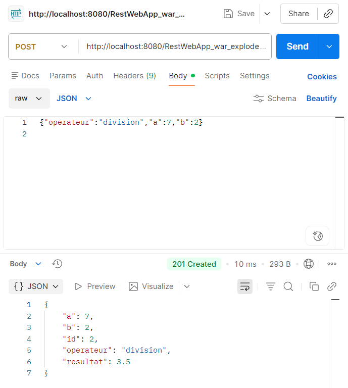
*Figure F2 : création avec Postman (onglet Body en raw / JSON), statut 201 Created*
 
#### Série de tests
 
Toutes les URI sont à préfixer par `BASE` (`http://localhost:8080/RestWebApp_war_exploded/api`).
 
| N° | Requête | Corps envoyé | Statut attendu | Réponse attendue | Capture |
|---|---|---|---|---|---|
| 1 | `POST /operations` | `{"operateur":"somme","a":8,"b":2}` | **201** | `{"a":8,"b":2,"id":1,"operateur":"somme","resultat":10.0}` et en-tête `Location` se terminant par `/operations/1` | F1, F2 |
| 2 | `POST /operations` | `{"operateur":"division","a":7,"b":2}` | **201** | Opération d'identifiant 2, de résultat 3.5 | F3 |
| 3 | `GET /operations` | aucun | **200** | Tableau JSON contenant les deux opérations | F4 |
| 4 | `GET /operations/2` | aucun | **200** | L'opération d'identifiant 2 | F5 |
| 5 | `GET /operations/99` | aucun | **404** | Corps vide | F6 |
| 6 | `POST /operations` | `{"operateur":"division","a":7,"b":0}` | **400** | `{"erreur":"Calcul impossible"}` | F7 |
| 7 | `POST /operations` | `{"operateur":"racine","a":9,"b":0}` | **400** | `{"erreur":"Calcul impossible"}` | F8 |
 
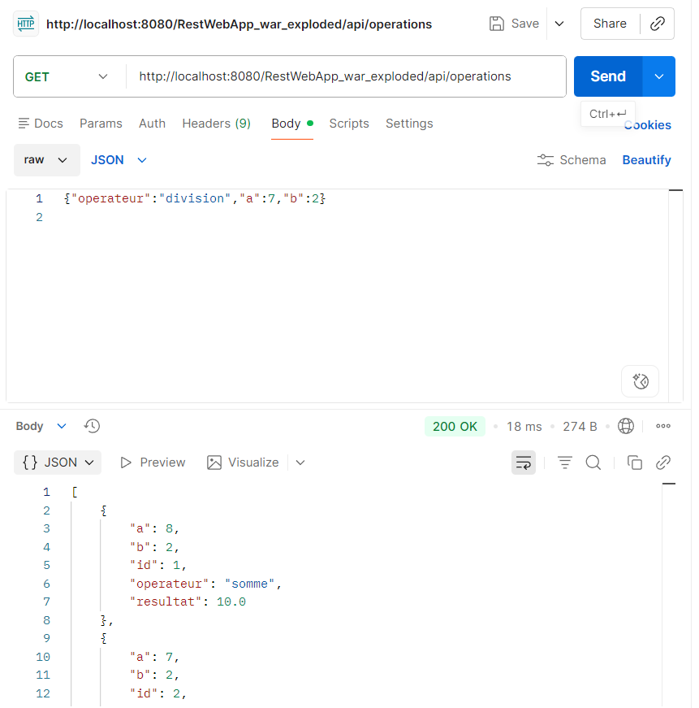
*Figure F3 : test 2, création d'une division, statut 201, id 2, résultat 3.5*
 
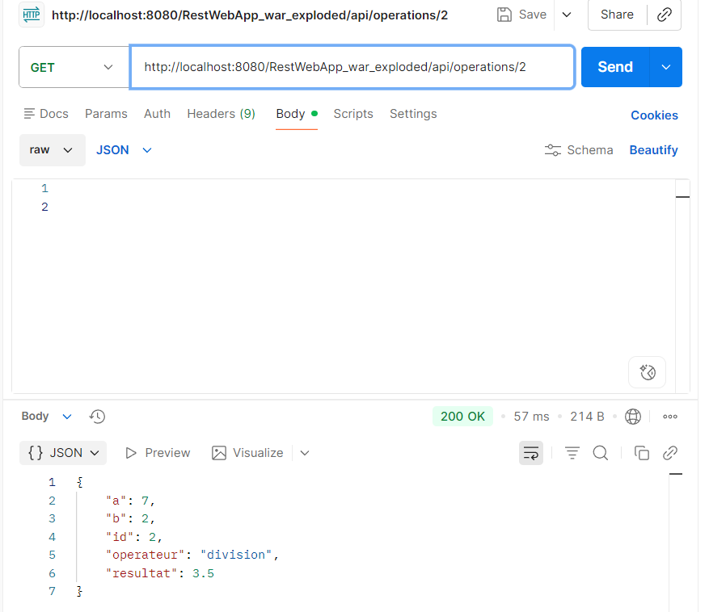
*Figure F4 : test 3, `GET /operations`, statut 200, tableau JSON*
 
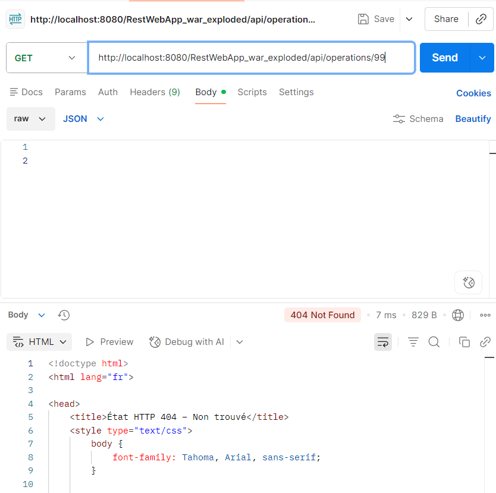
*Figure F5 : test 4, `GET /operations/2`, statut 200*
 
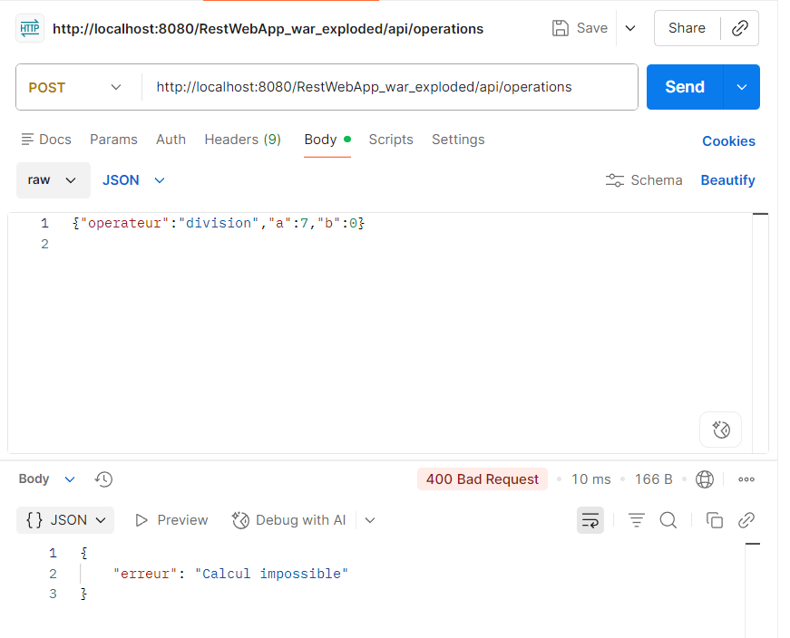
*Figure F6 : test 5, `GET /operations/99`, statut 404, corps vide*
 
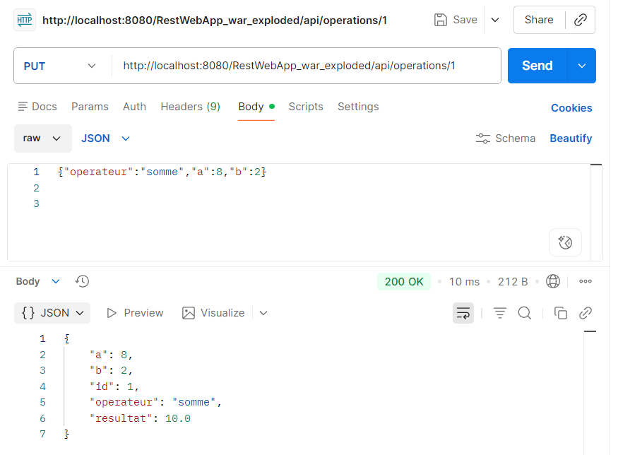
*Figure F7 : test 6, division par 0, statut 400 et message d'erreur*
 
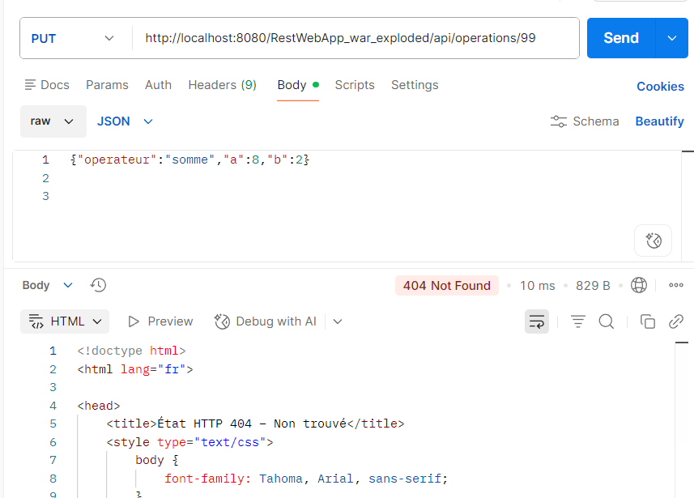
*Figure F8 : test 7, opérateur `racine` inconnu, statut 400*
 
#### Observations
 
- **201 et non 200** : une création réussie renvoie *Created*, avec l'en-tête `Location` qui donne l'adresse de la nouvelle ressource. Le client peut ainsi la relire directement.
- **Le serveur fixe l'id et le résultat** : même si le client envoyait un `id` ou un `resultat` dans le corps, ils sont écrasés (`calculer` recalcule le résultat, `setId` impose l'id).
- Les tests 6 et 7 sont des **erreurs du client** (400) : la requête est bien formée mais le calcul est impossible. Rien n'est enregistré et le compteur n'est pas incrémenté.
- Le test 5 renvoie **404 avec un corps vide** : il n'y a pas d'entité dans la réponse.
### F.4 Modifier une opération : PUT
 
Ajout dans `OperationRest` d'une méthode `modifier` qui répond à `PUT /operations/{id}`. Elle reçoit en JSON une opération (`operateur`, `a`, `b`) qui **remplace** celle d'identifiant `id`.
 
Import à ajouter : `jakarta.ws.rs.PUT`.
 
```java
    // PUT /operations/{id} : remplace une opération
    @PUT
    @Path("/{id}")
    @Consumes(MediaType.APPLICATION_JSON)
    public Response modifier(@PathParam("id") int id, Operation op) {
        if (!OPERATIONS.containsKey(id)) {
            return Response.status(Response.Status.NOT_FOUND).build();
        }
        if (!calculer(op)) {
            return Response.status(Response.Status.BAD_REQUEST)
                           .entity("{\"erreur\":\"Calcul impossible\"}")
                           .build();
        }
        op.setId(id);
        OPERATIONS.put(id, op);
        return Response.ok(op).build();
    }
```
 
**Comportement :**
 
| Situation | Statut | Corps de la réponse |
|---|---|---|
| Aucune opération ne porte cet identifiant | **404** | vide |
| Le calcul est impossible (opérateur inconnu, division par 0) | **400** | `{"erreur":"Calcul impossible"}` |
| Modification réussie | **200** | L'opération modifiée, avec le même `id` et le nouveau `resultat` |
 
**Choix de conception :**
- On vérifie d'abord l'**existence** (404), puis la **validité** du calcul (400) : PUT ne crée pas de ressource si l'identifiant n'existe pas.
- L'identifiant vient de l'**URI** (`op.setId(id)`) et non du corps : le client ne peut pas changer l'id d'une ressource.
- Si le calcul est impossible, l'opération existante **n'est pas modifiée** : `OPERATIONS.put` n'est atteint qu'après la validation.
- PUT **remplace** la ressource en entier : le corps doit contenir tous les champs (`operateur`, `a`, `b`).
**Tests :**
 
```bash
curl -i -X PUT -H "Content-Type: application/json" -d '{"operateur":"produit","a":8,"b":2}' "http://localhost:8080/RestWebApp_war_exploded/api/operations/1"
curl -i "http://localhost:8080/RestWebApp_war_exploded/api/operations/1"
curl -i -X PUT -H "Content-Type: application/json" -d '{"operateur":"somme","a":1,"b":1}' "http://localhost:8080/RestWebApp_war_exploded/api/operations/99"
curl -i -X PUT -H "Content-Type: application/json" -d '{"operateur":"division","a":1,"b":0}' "http://localhost:8080/RestWebApp_war_exploded/api/operations/1"
```
 
*(Sous Windows cmd, utiliser la syntaxe avec `\"` vue en F.3.)*
 
| N° | Requête | Corps | Statut attendu | Réponse attendue | Capture |
|---|---|---|---|---|---|
| 1 | `PUT /operations/1` | `{"operateur":"produit","a":8,"b":2}` | **200** | Opération 1 avec `resultat` à **16.0** | F9 |
| 2 | `GET /operations/1` | aucun | **200** | L'opération 1 modifiée (`produit`, résultat 16.0) | F10 |
| 3 | `PUT /operations/99` | `{"operateur":"somme","a":1,"b":1}` | **404** | Corps vide | F11 |
| 4 | `PUT /operations/1` | `{"operateur":"division","a":1,"b":0}` | **400** | `{"erreur":"Calcul impossible"}` | F12 |
 

*Figure F9 : `PUT /operations/1` avec `produit`, statut 200, résultat 16.0*
 

*Figure F10 : `GET /operations/1` après la modification*
 

*Figure F11 : `PUT /operations/99`, statut 404*
 

*Figure F12 : `PUT /operations/1` avec division par 0, statut 400*
 
### F.5 Supprimer une opération : DELETE
 
Ajout d'une méthode `supprimer` qui répond à `DELETE /operations/{id}`.
 
Import à ajouter : `jakarta.ws.rs.DELETE`.
 
```java
    // DELETE /operations/{id} : supprime une opération
    @DELETE
    @Path("/{id}")
    public Response supprimer(@PathParam("id") int id) {
        Operation supprimee = OPERATIONS.remove(id);
        if (supprimee == null) {
            return Response.status(Response.Status.NOT_FOUND).build();
        }
        return Response.noContent().build();
    }
```
 
| Situation | Statut | Corps de la réponse |
|---|---|---|
| Aucune opération ne porte cet identifiant | **404** | vide |
| Suppression réussie | **204 (No Content)** | vide |
 
`OPERATIONS.remove(id)` supprime l'opération **et retourne `null` si elle n'existait pas**. Un seul appel suffit pour tester et supprimer : on évite la séquence `containsKey` puis `remove`, qui ne serait pas sûre si deux requêtes arrivaient en même temps. `Response.noContent().build()` construit la réponse **204**, sans corps.
 
**Tests, dans l'ordre :**
 
```bash
curl -i -X DELETE "http://localhost:8080/RestWebApp_war_exploded/api/operations/1"
curl -i "http://localhost:8080/RestWebApp_war_exploded/api/operations/1"
curl -i -X DELETE "http://localhost:8080/RestWebApp_war_exploded/api/operations/1"
```
 
| N° | Requête | Statut attendu | Explication | Capture |
|---|---|---|---|---|
| 1 | `DELETE /operations/1` | **204** | L'opération 1 existe : elle est supprimée | F13 |
| 2 | `GET /operations/1` | **404** | Elle n'existe plus | F14 |
| 3 | `DELETE /operations/1` | **404** | Il n'y a plus rien à supprimer | F15 |
 

*Figure F13 : `DELETE /operations/1`, statut 204, corps vide*
 

*Figure F14 : `GET /operations/1` après la suppression, statut 404*
 

*Figure F15 : second `DELETE /operations/1`, statut 404*
 
L'identifiant supprimé n'est **pas réutilisé** : le compteur continue (la prochaine création aura l'id 3), ce qui évite qu'un ancien lien `/operations/1` désigne par erreur une nouvelle opération.
 
### Code complet de la classe finale
 
La classe `OperationRest` contient maintenant : `calculer` (méthode privée), `creer` (POST), `lister` (GET collection), `lire` (GET id), `modifier` (PUT) et `supprimer` (DELETE). Les imports ajoutés par rapport à F.2 sont `jakarta.ws.rs.PUT` et `jakarta.ws.rs.DELETE`.
 
<details>
<summary>Afficher le code complet de <code>OperationRest.java</code></summary>
```java
package com.exemple.rest;
 
import jakarta.ws.rs.Consumes;
import jakarta.ws.rs.DELETE;
import jakarta.ws.rs.GET;
import jakarta.ws.rs.POST;
import jakarta.ws.rs.PUT;
import jakarta.ws.rs.Path;
import jakarta.ws.rs.PathParam;
import jakarta.ws.rs.Produces;
import jakarta.ws.rs.core.Context;
import jakarta.ws.rs.core.MediaType;
import jakarta.ws.rs.core.Response;
import jakarta.ws.rs.core.UriInfo;
 
import java.net.URI;
import java.util.ArrayList;
import java.util.List;
import java.util.Map;
import java.util.concurrent.ConcurrentHashMap;
import java.util.concurrent.atomic.AtomicInteger;
 
@Path("/operations")
@Produces(MediaType.APPLICATION_JSON)
public class OperationRest {
 
    private static final Map<Integer, Operation> OPERATIONS = new ConcurrentHashMap<>();
    private static final AtomicInteger COMPTEUR = new AtomicInteger(0);
 
    private final Calculatrice calculService = new Calculatrice();
 
    private boolean calculer(Operation op) {
        if (op == null || op.getOperateur() == null) {
            return false;
        }
        switch (op.getOperateur()) {
            case "somme":
                op.setResultat(calculService.somme(op.getA(), op.getB()));
                return true;
            case "soustraction":
                op.setResultat(calculService.soustraction(op.getA(), op.getB()));
                return true;
            case "produit":
                op.setResultat(calculService.produit(op.getA(), op.getB()));
                return true;
            case "division":
                if (op.getB() == 0) {
                    return false;
                }
                op.setResultat(calculService.division(op.getA(), op.getB()));
                return true;
            default:
                return false;
        }
    }
 
    @POST
    @Consumes(MediaType.APPLICATION_JSON)
    public Response creer(Operation op, @Context UriInfo uriInfo) {
        if (!calculer(op)) {
            return Response.status(Response.Status.BAD_REQUEST)
                           .entity("{\"erreur\":\"Calcul impossible\"}")
                           .build();
        }
        int id = COMPTEUR.incrementAndGet();
        op.setId(id);
        OPERATIONS.put(id, op);
        URI location = uriInfo.getAbsolutePathBuilder().path(String.valueOf(id)).build();
        return Response.created(location).entity(op).build();
    }
 
    @GET
    public List<Operation> lister() {
        return new ArrayList<>(OPERATIONS.values());
    }
 
    @GET
    @Path("/{id}")
    public Response lire(@PathParam("id") int id) {
        Operation op = OPERATIONS.get(id);
        if (op == null) {
            return Response.status(Response.Status.NOT_FOUND).build();
        }
        return Response.ok(op).build();
    }
 
    @PUT
    @Path("/{id}")
    @Consumes(MediaType.APPLICATION_JSON)
    public Response modifier(@PathParam("id") int id, Operation op) {
        if (!OPERATIONS.containsKey(id)) {
            return Response.status(Response.Status.NOT_FOUND).build();
        }
        if (!calculer(op)) {
            return Response.status(Response.Status.BAD_REQUEST)
                           .entity("{\"erreur\":\"Calcul impossible\"}")
                           .build();
        }
        op.setId(id);
        OPERATIONS.put(id, op);
        return Response.ok(op).build();
    }
 
    @DELETE
    @Path("/{id}")
    public Response supprimer(@PathParam("id") int id) {
        Operation supprimee = OPERATIONS.remove(id);
        if (supprimee == null) {
            return Response.status(Response.Status.NOT_FOUND).build();
        }
        return Response.noContent().build();
    }
}
```
 
</details>
### Bilan de la partie F
 
| Verbe | URI | Succès | Erreurs | Idempotent ? |
|---|---|---|---|---|
| POST | `/operations` | 201 Created (+ `Location`) | 400 | Non |
| GET | `/operations` | 200 | | Oui |
| GET | `/operations/{id}` | 200 | 404 | Oui |
| PUT | `/operations/{id}` | 200 | 400, 404 | Oui |
| DELETE | `/operations/{id}` | 204 No Content | 404 | Oui (état final identique) |
 
---
 
## 10. Questions de synthèse
 
### 1. Tableau de l'étape A.1 avec les codes de statut HTTP
 
| Verbe | URI | Rôle | Statuts que le service peut renvoyer |
|---|---|---|---|
| GET | `/calcul/somme?a=2&b=3` | Retourne a + b | **200** ; 404 si un paramètre n'est pas un entier ; 405 si un autre verbe est utilisé |
| GET | `/calcul/soustraction?a=2&b=3` | Retourne a − b | **200** ; 404 (paramètre non entier) ; 405 |
| GET | `/calcul/produit?a=2&b=3` | Retourne a × b | **200** ; 404 (paramètre non entier) ; 405 |
| GET | `/calcul/division?a=6&b=3` | Retourne a ÷ b | **200** ; **400** si b = 0 ; 404 (paramètre non entier) ; 405 |
| POST | `/operations` | Crée une opération | **201** ; **400** (calcul impossible) ; 415 si le `Content-Type` n'est pas JSON ; 406 si `Accept` n'est pas JSON |
| GET | `/operations` | Retourne toutes les opérations | **200** ; 406 si `Accept` n'est pas JSON |
| GET | `/operations/{id}` | Retourne l'opération numéro id | **200** ; **404** (id inexistant) ; 406 |
| PUT | `/operations/{id}` | Modifie l'opération numéro id | **200** ; **400** (calcul impossible) ; **404** (id inexistant) ; 415 ; 406 |
| DELETE | `/operations/{id}` | Supprime l'opération numéro id | **204** ; **404** (id inexistant) |
 
### 2. Annotations JAX-RS utilisées dans ce TP
 
| Annotation | Rôle |
|---|---|
| `@ApplicationPath("/api")` | Active JAX-RS dans l'application web et fixe le préfixe commun de toutes les URI |
| `@Path` | Associe une classe ou une méthode à une partie de l'URI (`{id}` désigne une variable) |
| `@GET` | La méthode répond aux requêtes HTTP GET (lecture) |
| `@POST` | La méthode répond aux requêtes HTTP POST (création) |
| `@PUT` | La méthode répond aux requêtes HTTP PUT (remplacement d'une ressource) |
| `@DELETE` | La méthode répond aux requêtes HTTP DELETE (suppression) |
| `@Produces` | Déclare le type de contenu renvoyé (`text/plain`, `application/json`) et sert à la négociation avec l'en-tête `Accept` |
| `@Consumes` | Déclare le type de contenu accepté dans le corps de la requête (`application/json`) |
| `@QueryParam` | Lit un paramètre de requête (`?a=2`) et le convertit dans le type Java |
| `@PathParam` | Lit une variable du chemin (`/operations/{id}`) |
| `@Context` | Demande à Jersey d'injecter un objet de contexte (ici `UriInfo`) |
 
### 3. Différence entre JAX-RS et Jersey
 
- **JAX-RS** (*Jakarta RESTful Web Services*) est une **spécification** : elle définit l'API (les annotations `@Path`, `@GET`, la classe `Response`...) mais ne contient aucun moteur. Dans le `pom.xml` : `jakarta.ws.rs-api`.
- **Jersey** est une **implémentation** de cette spécification (l'implémentation de référence). Elle lit les annotations, analyse les requêtes HTTP, appelle les bonnes méthodes, convertit les objets en JSON. Dans le `pom.xml` : `jersey-container-servlet`, `jersey-hk2`, `jersey-media-json-binding`.
Analogie : JAX-RS est à Jersey ce que JDBC est à un pilote de base de données. Le code écrit avec les annotations JAX-RS pourrait tourner avec une autre implémentation (RESTEasy, Apache CXF) sans changement.
 
### 4. Rôle de Tomcat, et pourquoi un `.war` et non un `.jar` exécutable
 
**Rôle de Tomcat :** c'est un **conteneur de servlets** (serveur d'applications web). Il écoute sur le port 8080, reçoit les requêtes HTTP, gère le cycle de vie de l'application, et transmet les requêtes à la servlet de Jersey, qui les distribue aux classes `@Path`. Il déploie l'application à partir du dossier `webapps` et lui donne son contexte (`/RestWebApp`).
 
**Pourquoi un `.war` ?** Notre application **n'est pas autonome** : elle n'a ni méthode `main`, ni serveur HTTP intégré. Elle a besoin d'un conteneur qui la fait vivre. Le `.war` (*Web ARchive*) est le format standard d'une application web destinée à un conteneur : il regroupe les classes (`WEB-INF/classes`), les bibliothèques (`WEB-INF/lib`) et les ressources, et Tomcat sait le décompresser et le déployer. Un `.jar` exécutable aurait été utilisé si l'application embarquait son propre serveur (approche de Spring Boot, par exemple), ce qui n'est pas le cas ici.
 
### 5. Principe stateless et liste des opérations conservée
 
Le principe **stateless** porte sur l'**état de la conversation avec le client** : le serveur ne garde pas, entre deux requêtes, d'information sur *ce client* (session, étape en cours, « dernière requête »). Chaque requête contient tout ce qu'il faut pour être traitée : verbe, URI, paramètres, corps.
 
La liste des opérations est un **état de la ressource**, pas un état du client :
- elle est **partagée par tous les clients** et ne dépend d'aucun d'eux ;
- elle est **identifiée par une URI** (`/operations/2`), que n'importe quel client peut demander à n'importe quel moment ;
- la réponse à `GET /operations/2` ne dépend pas des requêtes précédentes *de ce client* : elle dépend seulement de l'état des données.
Il n'y a **aucune session** : si le serveur oubliait « qui a fait quoi », le service fonctionnerait de la même façon. C'est un stockage de **données**, comme le ferait une base de données. Remarque : le stockage en mémoire est une simplification du TP, car avec plusieurs instances du serveur chacune aurait sa propre liste. En production, on utiliserait une base de données partagée, ce qui conserve le caractère stateless du service.
 
### 6. Répétition de POST et de PUT
 
| | POST `/operations` envoyé 2 fois | PUT `/operations/1` envoyé 2 fois |
|---|---|---|
| 1re requête | Crée l'opération d'id 1 (**201**) | Remplace l'opération 1 (**200**) |
| 2e requête | Crée **une nouvelle** opération d'id 2 (**201**) | Remplace l'opération 1 par le **même contenu** (**200**) |
| Effet final | **Deux** ressources identiques (ids 1 et 2) | **Une seule** ressource, dans le même état qu'après la 1re requête |
| Propriété | **Non idempotent** | **Idempotent** |
 
**Conclusion :** répéter un POST **change l'état du serveur à chaque fois** (un doublon est créé), alors que répéter un PUT **donne le même résultat que de l'envoyer une seule fois**. C'est pour cela qu'un client peut renvoyer un PUT sans risque après une erreur réseau, alors qu'il doit être prudent avec un POST (risque de doublon). GET et DELETE sont également idempotents (pour DELETE, le statut change de 204 à 404, mais l'état final est le même).
 
---
 
## 11. Tests avec Postman
 
**Postman** est un client HTTP graphique. Contrairement au navigateur (limité à GET), il permet de choisir n'importe quel verbe, d'ajouter des paramètres, des en-têtes et un corps, et de **vérifier automatiquement** les réponses avec des scripts. Cette section regroupe l'ensemble des tests du service avec Postman.
 
### 11.1 Préparation
 
**a) Créer une collection**
 
1. Dans Postman : **New > Collection**, nom : `TP2 - Calculatrice REST`.
2. Toutes les requêtes seront rangées dans cette collection.
**b) Définir une variable d'environnement de collection**
 
Pour ne pas répéter l'adresse du serveur dans chaque requête, on crée une variable `base_url` (onglet **Variables** de la collection) :
 
| Variable | Valeur |
|---|---|
| `base_url` | `http://localhost:8080/RestWebApp_war_exploded/api` |
 
Chaque requête utilise ensuite `{{base_url}}/calcul/somme`. Si le contexte change (par exemple `/RestWebApp` avec un `.war` déposé dans `webapps`), il suffit de modifier cette variable.
 

*Figure 19 : collection `TP2 - Calculatrice REST` et variable `base_url`*
 
### 11.2 Liste des requêtes testées
 
| N° | Nom de la requête | Verbe | URL | Statut attendu | Corps attendu |
|---|---|---|---|---|---|
| 1 | Hello World | GET | `{{base_url}}/hello-world` | 200 | `Hello, World!` |
| 2 | Somme | GET | `{{base_url}}/calcul/somme?a=2&b=3` | 200 | `5` |
| 3 | Somme avec POST | POST | `{{base_url}}/calcul/somme?a=2&b=3` | 405 | vide |
| 4 | Soustraction | GET | `{{base_url}}/calcul/soustraction?a=10&b=4` | 200 | `6` |
| 5 | Produit | GET | `{{base_url}}/calcul/produit?a=6&b=7` | 200 | `42` |
| 6 | Produit avec `@PathParam` | GET | `{{base_url}}/calcul/produit/6/7` | 200 | `42` |
| 7 | Somme, `b` absent | GET | `{{base_url}}/calcul/somme?a=2` | 200 | `2` |
| 8 | Somme, `a` non entier | GET | `{{base_url}}/calcul/somme?a=abc&b=3` | 404 | non exécutée |
| 9 | Division | GET | `{{base_url}}/calcul/division?a=7&b=2` | 200 | `3.5` |
| 10 | Division par zéro | GET | `{{base_url}}/calcul/division?a=7&b=0` | 400 | `Erreur : division par 0 impossible` |
| 11 | Somme détaillée (JSON) | GET | `{{base_url}}/calcul/somme/detail?a=2&b=3` (`Accept: application/json`) | 200 | `{"a":2,"b":3,"operation":"somme","resultat":5.0}` |
| 12 | Somme détaillée, Accept XML | GET | `{{base_url}}/calcul/somme/detail?a=2&b=3` (`Accept: application/xml`) | 406 | non acceptable |
| 13 | Division détaillée (JSON) | GET | `{{base_url}}/calcul/division/detail?a=7&b=2` | 200 | `{"a":7,"b":2,"operation":"division","resultat":3.5}` |
| 14 | Division détaillée par zéro | GET | `{{base_url}}/calcul/division/detail?a=7&b=0` | 400 | `{"erreur":"Division par 0 impossible"}` |
| 15 | Créer une somme | POST | `{{base_url}}/operations` | 201 | `{"a":8,"b":2,"id":1,"operateur":"somme","resultat":10.0}` + en-tête `Location` |
| 16 | Créer une division | POST | `{{base_url}}/operations` | 201 | opération d'id 2, résultat `3.5` |
| 17 | Lister les opérations | GET | `{{base_url}}/operations` | 200 | tableau JSON des opérations |
| 18 | Lire une opération | GET | `{{base_url}}/operations/{{op2}}` | 200 | l'opération n° 2 |
| 19 | Lire un id inexistant | GET | `{{base_url}}/operations/99` | 404 | vide |
| 20 | Créer, division par 0 | POST | `{{base_url}}/operations` | 400 | `{"erreur":"Calcul impossible"}` |
| 21 | Créer, opérateur inconnu | POST | `{{base_url}}/operations` | 400 | `{"erreur":"Calcul impossible"}` |
| 22 | Modifier une opération | PUT | `{{base_url}}/operations/{{op1}}` | 200 | `resultat` à `16.0` |
| 23 | Relire après modification | GET | `{{base_url}}/operations/{{op1}}` | 200 | opération n° 1 modifiée |
| 24 | Modifier un id inexistant | PUT | `{{base_url}}/operations/99` | 404 | vide |
| 25 | Modifier, calcul impossible | PUT | `{{base_url}}/operations/{{op1}}` | 400 | `{"erreur":"Calcul impossible"}` |
| 26 | Supprimer une opération | DELETE | `{{base_url}}/operations/{{op1}}` | 204 | vide |
| 27 | Relire après suppression | GET | `{{base_url}}/operations/{{op1}}` | 404 | vide |
| 28 | Supprimer à nouveau | DELETE | `{{base_url}}/operations/{{op1}}` | 404 | vide |
 
### 11.3 Procédure d'envoi d'une requête
 
Exemple avec la **somme** :
 
1. Dans la collection : **Add request**, nom `Somme`.
2. Choisir le verbe **GET**.
3. Saisir l'URL `{{base_url}}/calcul/somme`.
4. Ouvrir l'onglet **Params** et ajouter deux lignes :
   | Key | Value |
   |---|---|
   | `a` | `2` |
   | `b` | `3` |
   Postman reconstruit automatiquement l'URL `…/calcul/somme?a=2&b=3`.
5. Cliquer sur **Send**.
6. Observer dans la partie réponse :
   - **Body** : `5`
   - **Status** : `200 OK`
   - **Headers** : `Content-Type: text/plain`
   - le temps de réponse et la taille.

*Figure 20 : requête GET Somme, statut 200 OK, corps `5`*
 
On répète la même procédure pour les autres requêtes.
 
**Soustraction** (`a=10`, `b=4`, résultat attendu `6`) :
 

*Figure 21 : requête GET Soustraction, statut 200 OK, corps `6`*
 
**Produit** (`a=6`, `b=7`, résultat attendu `42`) :
 

*Figure 22 : requête GET Produit, statut 200 OK, corps `42`*
 
**Produit avec `@PathParam`** : les valeurs sont placées dans le chemin (`/calcul/produit/6/7`), sans onglet Params :
 

*Figure 23 : requête GET `/calcul/produit/6/7`, statut 200 OK, corps `42`*
 
**Division** (`a=7`, `b=2`, résultat attendu `3.5`) et **division par zéro** (`a=7`, `b=0`, statut attendu **400** avec le message d'erreur) :
 

*Figure 23a : requête GET Division, statut 200 OK, corps `3.5`*
 

*Figure 23b : requête GET Division par zéro, statut 400 Bad Request, corps `Erreur : division par 0 impossible`*
 
**Réponses JSON** (requêtes 11 à 14, partie E) : pour demander du JSON, ajouter dans l'onglet **Headers** la ligne `Accept` = `application/json`. Pour provoquer le **406**, remplacer la valeur par `application/xml`.
 

*Figure 23c : requête GET `/calcul/somme/detail`, statut 200 OK, corps JSON (onglet Body en mode Pretty)*
 

*Figure 23d : même requête avec `Accept: application/xml`, statut 406 Not Acceptable*
 
### 11.4 Test d'un verbe non autorisé (POST)
 
1. Dupliquer la requête `Somme` et la renommer `Somme avec POST`.
2. Changer le verbe **GET** en **POST**.
3. Cliquer sur **Send**.
Résultat : statut **405 Method Not Allowed**. L'URI `/calcul/somme` existe, mais aucune méthode Java n'y répond au verbe POST. La réponse contient l'en-tête `Allow` qui indique les verbes acceptés (onglet **Headers** de la réponse).
 

*Figure 24 : requête POST sur `/calcul/somme`, statut 405*
 
### 11.5 Test des paramètres absents et invalides
 
| Requête | Statut | Explication |
|---|---|---|
| `somme?a=2` (b absent) | 200, corps `2` | `b` prend la valeur par défaut de `int` (0), donc 2 + 0 |
| `somme?a=abc&b=3` | 404 | `"abc"` ne peut pas être converti en `int`, la méthode n'est pas exécutée |
 

*Figure 25 : somme avec `b` absent (200, corps `2`)*
 

*Figure 26 : somme avec `a=abc` (404)*
 
### 11.6 Tests automatiques avec l'onglet « Tests »
 
Postman exécute un script JavaScript après chaque réponse. Il permet de **valider automatiquement** le statut, le type de contenu et le corps, au lieu de vérifier visuellement. Dans l'onglet **Tests** de la requête `Somme` :
 
```javascript
pm.test("Statut 200 OK", function () {
    pm.response.to.have.status(200);
});
 
pm.test("Content-Type est text/plain", function () {
    pm.response.to.have.header("Content-Type");
    pm.expect(pm.response.headers.get("Content-Type")).to.include("text/plain");
});
 
pm.test("Le résultat de 2 + 3 est 5", function () {
    pm.expect(pm.response.text()).to.eql("5");
});
```
 
Pour la requête `Division par zéro` (le test vérifie le statut **et** le message d'erreur) :
 
```javascript
pm.test("Statut 400 Bad Request", function () {
    pm.response.to.have.status(400);
});
 
pm.test("Message d'erreur correct", function () {
    pm.expect(pm.response.text()).to.eql("Erreur : division par 0 impossible");
});
```
 
Pour la requête `Division` (7 ÷ 2) :
 
```javascript
pm.test("Statut 200 OK", function () {
    pm.response.to.have.status(200);
});
 
pm.test("7 / 2 = 3.5", function () {
    pm.expect(pm.response.text()).to.eql("3.5");
});
```
 
Pour la requête `Somme détaillée (JSON)` (le test lit le corps comme un objet JSON) :
 
```javascript
pm.test("Statut 200 OK", function () {
    pm.response.to.have.status(200);
});
 
pm.test("Content-Type est application/json", function () {
    pm.expect(pm.response.headers.get("Content-Type")).to.include("application/json");
});
 
pm.test("Le JSON contient le bon détail", function () {
    var json = pm.response.json();
    pm.expect(json.operation).to.eql("somme");
    pm.expect(json.a).to.eql(2);
    pm.expect(json.b).to.eql(3);
    pm.expect(json.resultat).to.eql(5);
});
```
 
Pour la requête `Somme détaillée, Accept XML` :
 
```javascript
pm.test("Statut 406 Not Acceptable", function () {
    pm.response.to.have.status(406);
});
```
 
Pour la requête `Somme avec POST` :
 
```javascript
pm.test("Statut 405 Method Not Allowed", function () {
    pm.response.to.have.status(405);
});
```
 
Après **Send**, l'onglet **Test Results** de la réponse affiche chaque test en **PASS** (vert) ou **FAIL** (rouge).
 

*Figure 27 : onglet Test Results, tous les tests passent*
 
### 11.7 Exécution de toute la collection (Collection Runner)
 
1. Clic droit sur la collection, puis **Run collection**.
2. Cocher les 28 requêtes (ou seulement le dossier `Partie F - operations`, à exécuter dans l'ordre), puis **Run**.
3. Postman les exécute à la suite et affiche le bilan : requêtes réussies, tests passés ou échoués, temps de réponse.

*Figure 28 : exécution de la collection avec le Collection Runner*
 
### 11.8 Import de la collection fournie
 
Le fichier `postman/TP2-Calculatrice.postman_collection.json` du dépôt contient les 28 requêtes avec leurs tests (les 14 premières, puis le dossier `Partie F - operations`). Pour l'utiliser : **Import** dans Postman, puis sélection du fichier. Vérifier la valeur de la variable `base_url` avant de lancer les requêtes.
 
### 11.9 Tests de la ressource `operations` (partie F)
 
Les requêtes 15 à 28 testent la ressource `operations` avec les quatre verbes. Elles sont rangées dans un **dossier** de la collection, `Partie F - operations`, et doivent être **exécutées dans l'ordre**.
 
**Création avec Postman (POST) :**
 
1. Verbe **POST**, URL `{{base_url}}/operations`.
2. Onglet **Body**, option **raw**, type **JSON**.
3. Corps : `{"operateur":"somme","a":8,"b":2}`. Postman ajoute l'en-tête `Content-Type: application/json`.
4. **Send** : statut **201 Created**, corps JSON, en-tête `Location` dans l'onglet **Headers**.
**Variables `op1` et `op2` :** pour ne pas dépendre de la numérotation (qui repart de 1 à chaque redéploiement), les tests des deux premiers POST **enregistrent l'id reçu** dans des variables de collection :
 
```javascript
pm.test("Statut 201 Created", function () {
    pm.response.to.have.status(201);
});
 
pm.test("En-tête Location présent", function () {
    pm.expect(pm.response.headers.get("Location")).to.include("/operations/");
});
 
pm.test("Résultat de 8 + 2 = 10", function () {
    var json = pm.response.json();
    pm.expect(json.resultat).to.eql(10);
    pm.collectionVariables.set("op1", json.id);
});
```
 
Les requêtes suivantes utilisent `{{op1}}` et `{{op2}}` dans l'URL (par exemple `{{base_url}}/operations/{{op1}}`).
 
Exemple de test pour le **PUT** :
 
```javascript
pm.test("Statut 200 OK", function () {
    pm.response.to.have.status(200);
});
 
pm.test("Résultat de 8 x 2 = 16", function () {
    var json = pm.response.json();
    pm.expect(json.operateur).to.eql("produit");
    pm.expect(json.resultat).to.eql(16);
});
```
 
Exemple de test pour le **DELETE** :
 
```javascript
pm.test("Statut 204 No Content", function () {
    pm.response.to.have.status(204);
});
 
pm.test("Corps vide", function () {
    pm.expect(pm.response.text()).to.eql("");
});
```
 

*Figure F16 : exécution du dossier `Partie F - operations` avec le Collection Runner, tous les tests passent*
 
### 11.10 Conclusion sur Postman
 
| Critère | Navigateur | curl | Postman |
|---|---|---|---|
| Verbes autres que GET | Non | Oui (`-X`) | Oui |
| Affichage du statut et des en-têtes | Limité | Oui (`-i`) | Oui, interface graphique |
| Paramètres, en-têtes, corps JSON | Non | Oui, en ligne de commande | Oui, onglets dédiés |
| Tests automatiques | Non | Non (sauf script externe) | Oui (onglet Tests, Runner) |
| Sauvegarde et partage des requêtes | Non | Non | Oui (collections) |
 
---
 
## 12. Récapitulatif des tests
 
| Fonction | Requête | Statut | Résultat |
|---|---|---|---|
| Hello World | `GET BASE/hello-world` | 200 | `Hello, World!` |
| Somme | `GET BASE/calcul/somme?a=2&b=3` | 200 | `5` |
| Somme (POST) | `POST BASE/calcul/somme?a=2&b=3` | 405 | Méthode non autorisée |
| Soustraction | `GET BASE/calcul/soustraction?a=10&b=4` | 200 | `6` |
| Produit | `GET BASE/calcul/produit?a=6&b=7` | 200 | `42` |
| Produit (chemin) | `GET BASE/calcul/produit/6/7` | 200 | `42` |
| Paramètre absent | `GET BASE/calcul/somme?a=2` | 200 | `2` |
| Paramètre invalide | `GET BASE/calcul/somme?a=abc&b=3` | 404 | Méthode non exécutée |
| Division | `GET BASE/calcul/division?a=7&b=2` | 200 | `3.5` |
| Division par zéro | `GET BASE/calcul/division?a=7&b=0` | 400 | `Erreur : division par 0 impossible` |
| Somme détaillée (JSON) | `GET BASE/calcul/somme/detail?a=2&b=3` | 200 | `{"a":2,"b":3,"operation":"somme","resultat":5.0}` |
| Somme détaillée, `Accept: application/json` | `GET BASE/calcul/somme/detail?a=2&b=3` | 200 | JSON |
| Somme détaillée, `Accept: application/xml` | `GET BASE/calcul/somme/detail?a=2&b=3` | 406 | Format non acceptable |
| Division détaillée (JSON) | `GET BASE/calcul/division/detail?a=7&b=2` | 200 | `{"a":7,"b":2,"operation":"division","resultat":3.5}` |
| Division détaillée par zéro | `GET BASE/calcul/division/detail?a=7&b=0` | 400 | `{"erreur":"Division par 0 impossible"}` |
| Créer une somme | `POST BASE/operations` | 201 | opération id 1, résultat 10.0, en-tête `Location` |
| Créer une division | `POST BASE/operations` | 201 | opération id 2, résultat 3.5 |
| Lister | `GET BASE/operations` | 200 | tableau JSON |
| Lire l'opération 2 | `GET BASE/operations/2` | 200 | l'opération 2 |
| Lire un id inexistant | `GET BASE/operations/99` | 404 | corps vide |
| Division par 0 | `POST BASE/operations` | 400 | `{"erreur":"Calcul impossible"}` |
| Opérateur inconnu | `POST BASE/operations` | 400 | `{"erreur":"Calcul impossible"}` |
| Modifier | `PUT BASE/operations/1` | 200 | résultat 16.0 |
| Modifier, id inexistant | `PUT BASE/operations/99` | 404 | corps vide |
| Modifier, calcul impossible | `PUT BASE/operations/1` | 400 | `{"erreur":"Calcul impossible"}` |
| Supprimer | `DELETE BASE/operations/1` | 204 | corps vide |
| Relire après suppression | `GET BASE/operations/1` | 404 | corps vide |
| Supprimer à nouveau | `DELETE BASE/operations/1` | 404 | corps vide |
 
---
 
## 13. Conclusion
 
Ce TP nous a permis de :
 
- **concevoir** une API REST : une ressource par concept, des URI claires, et le verbe HTTP adapté à chaque action (GET pour lire, POST pour créer) ;
- **créer** un projet Maven de type `war` avec les dépendances Jersey / JAX-RS (Jakarta EE 10) ;
- **écrire** un service avec les annotations `@ApplicationPath`, `@Path`, `@GET`, `@Produces`, `@QueryParam` et `@PathParam`, en séparant la logique métier (`Calculatrice`) de l'exposition REST (`CalculRest`) ;
- **gérer une erreur côté client** : la division par zéro renvoie un statut **400** avec un message explicite, au lieu d'une erreur interne 500 ;
- **échanger des données en JSON** : une méthode renvoie un objet Java (`Resultat`) et Jersey le convertit automatiquement grâce à `jersey-media-json-binding` ; les noms des champs viennent des getters ;
- **comprendre la négociation de contenu** : l'en-tête `Accept` du client est comparé au `@Produces` de la méthode, et un format indisponible donne un **406** ;
- **pratiquer les quatre verbes HTTP** sur la ressource `operations` : POST (201 + `Location`), GET, PUT (remplacement, idempotent) et DELETE (204), avec un stockage en mémoire partagé et sûr pour les accès simultanés (`static`, `ConcurrentHashMap`, `AtomicInteger`) ;
- **déployer** l'application dans **Tomcat 10.1** et vérifier la chaîne complète avec l'exemple Hello World ;
- **tester** le service avec le navigateur, curl et Postman, et **interpréter les codes de statut** : 200 (succès), 201 (créé), 204 (pas de contenu), 400 (requête incorrecte), 404 (ressource ou paramètre non trouvé), 405 (verbe non autorisé), 406 (format de réponse non acceptable).
Toutes les parties du TP sont traitées. Les réponses aux questions de synthèse figurent à la [section 10](#10-questions-de-synthèse).
 
---
 
## 14. Annexe : structure du dépôt
 
```
TP2-MS/
├── README.md
├── images/                 (captures d'écran citées dans ce compte rendu)
├── pom.xml
└── src/
    └── main/
        └── java/
            └── com/exemple/rest/
                ├── Calculatrice.java       (logique métier)
                ├── RestApplication.java    (activation de JAX-RS)
                ├── CalculRest.java         (ressource /calcul)
                ├── Resultat.java           (objet renvoyé en JSON)
                ├── Operation.java          (objet de l'historique)
                └── OperationRest.java      (ressource /operations)
```
 
